# Branch Coverage Analysis & Report

**Course/Lab**: Lab 6 — Code and Branch Coverage Analysis  
**Module Under Test**: `vending_machine.py`  
**Test Suite**: `BranchCoverageTest_vending_machine.py`  
**Target Requirement**: $\ge 90\%$ Branch Coverage  
**Outcome**: **100% Branch Coverage** (18/18 branches) & **100% Line Coverage** (30/30 statements)

---

## 1. Concept: Line vs. Branch Coverage
Branch coverage ensures that every decision point (conditional branch, loop condition, exception condition) evaluates to both `True` and `False` at least once:
$$\text{Branch Coverage} = \frac{\text{Branches Evaluated Both True and False}}{\text{Total Decision Branches}} \times 100\%$$

In contrast to line coverage, branch coverage forces tests to address edge cases, negative boundary checks, loop termination, and failure modes.

---

## 2. Decision Structures & Control Flow

The decision branches in `vending_machine.py` are mapped as follows:

```mermaid
flowchart TD
    subgraph select_item
        A["item not in PRICES?"] -->|True| A1["return 'invalid'"]
        A -->|False| B["stock.get(item, 0) == 0?"]
        B -->|True| B1["return 'sold_out'"]
        B -->|False| C["credit < PRICES[item]?"]
        C -->|True| C1["return 'insufficient'"]
        C -->|False| C2["return 'ok'"]
    end

    subgraph make_change
        D["amount < 0?"] -->|True| D1["raise ValueError"]
        D -->|False| E["for coin in COINS"]
        E --> F["while amount >= coin?"]
        F -->|True| F1["append coin, amount -= coin"]
        F1 --> F
        F -->|False| E
        E -->|Exhausted| G["amount > 0?"]
        G -->|True| G1["return None"]
        G -->|False| G2["return coins"]
    end

    subgraph purchase
        H["status != 'ok'?"] -->|True| H1["return status, []"]
        H -->|False| I["make_change(...)"]
        I --> J["change is None?"]
        J -->|True| J1["return 'no_exact_change', []"]
        J -->|False| J2["stock[item] -= 1<br/>return 'dispensed', change"]
    end
```



---

## 3. Targeted Branch Test Case Mapping (19 Tests)

### `select_item`
1. `test_select_item_invalid`: `item not in PRICES` evaluates to `True`.
2. `test_select_item_sold_out_zero_stock`: `stock.get(item, 0) == 0` evaluates to `True` (explicit 0).
3. `test_select_item_sold_out_missing_key`: `stock.get(item, 0) == 0` evaluates to `True` (missing key in dict).
4. `test_select_item_insufficient_credit`: `credit < PRICES[item]` evaluates to `True`.
5. `test_select_item_ok_exact_credit`: `credit == PRICES[item]` evaluates to `False` (boundary equality).
6. `test_select_item_ok_surplus_credit`: `credit > PRICES[item]` evaluates to `False` (surplus credit).

### `make_change`
7. `test_make_change_negative`: `amount < 0` evaluates to `True` $\rightarrow$ raises `ValueError`.
8. `test_make_change_zero`: `amount == 0` $\rightarrow$ while loop body skipped for all coins, `amount > 0` evaluates to `False`.
9. `test_make_change_all_denominations`: Exercises each coin in `[100, 50, 25, 10, 5]`.
10. `test_make_change_multiple_same_coin`: `while amount >= coin` executed multiple consecutive times.
11. `test_make_change_partial_coins`: Skips larger coins (evaluates to `False`) and uses smaller denominations.
12. `test_make_change_impossible_remainder_small`: `amount > 0` evaluates to `True` ($3 < 5$).
13. `test_make_change_impossible_remainder_after_coins`: `amount > 0` evaluates to `True` ($7 - 5 = 2 > 0$).

### `purchase`
14. `test_purchase_status_invalid_item`: `status != 'ok'` evaluates to `True` (invalid item).
15. `test_purchase_status_sold_out`: `status != 'ok'` evaluates to `True` (sold out item, stock unchanged).
16. `test_purchase_status_insufficient_credit`: `status != 'ok'` evaluates to `True` (insufficient credit, stock unchanged).
17. `test_purchase_no_exact_change`: `change is None` evaluates to `True` $\rightarrow$ returns `("no_exact_change", [])`, stock unchanged.
18. `test_purchase_success_exact_payment`: `change == []` $\rightarrow$ item dispensed, stock decremented.
19. `test_purchase_success_with_change`: `change is not None` $\rightarrow$ change returned, item dispensed, stock decremented.

---

## 4. Execution Commands & Terminal Output

### Commands
```powershell
cd lab6
coverage run --branch -m pytest BranchCoverageTest_vending_machine.py
coverage report -m
```

### Terminal Output Summary
```
============================= test session starts =============================
platform win32 -- Python 3.12.10, pytest-9.1.1, pluggy-1.6.0
rootdir: C:\Users\siasi\Downloads\Lab6\L6_L7_30_vending_machine\lab6
plugins: anyio-4.14.0
collected 19 items

BranchCoverageTest_vending_machine.py ...................                [100%]

============================= 19 passed in 0.10s ==============================
Name                                    Stmts   Miss Branch BrPart  Cover   Missing
-----------------------------------------------------------------------------------
BranchCoverageTest_vending_machine.py      63      0      0      0   100%
vending_machine.py                         30      0     18      0   100%
-----------------------------------------------------------------------------------
TOTAL                                      93      0     18      0   100%
```

---

## 5. Comparative Coverage Summary

| Metric | Initial State | Code Coverage Phase | Branch Coverage Phase |
|---|:---:|:---:|:---:|
| **Statements (`vending_machine.py`)** | 43% (13/30) | **90%** (27/30) | **100%** (30/30) |
| **Branches (`vending_machine.py`)** | 40% | **88%** (3 partial branches) | **100%** (18/18 branches) |
| **Missing Lines** | 8–12, 17, 21–22, 24, 29–36 | 17, 24, 34 | **None** |
| **Passing Tests** | 2 | 8 | 19 |

---

## 6. Screenshot Deliverable
The terminal output screenshot verifying 100% branch coverage is saved at:
- `lab6/branch_coverage_screenshot.png`
